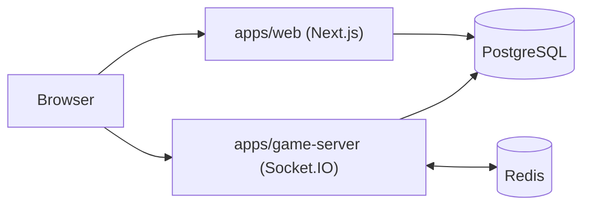

# Pawnstorm

A mini Chess.com-style platform: play live rated chess against humans with
server-authoritative clocks, practice against Stockfish in the browser, and
review every game with engine analysis.


*(Screenshot placeholder — run `pnpm dev`, play a game, and replace this.)*

## Features

- **Online play** — matchmaking by rating across bullet/blitz/rapid time
  controls, live clocks, draws, resignation, disconnect grace + rejoin.
- **Server-authoritative** — every move validated with chess.js on the server;
  clocks, turns, and results never trust the client.
- **Vs computer** — Stockfish (WASM, Web Worker) with 5 casual levels.
- **Accounts + guests** — credentials auth, guest sessions, Elo ratings,
  game history, profiles with rating graphs, leaderboard.
- **Review** — per-position Stockfish evals, eval bar + graph, blunder /
  mistake / inaccuracy flags.
- **Realtime protocol** — typed Socket.IO events with zod validation, defined
  once in `packages/shared` and documented in [docs/protocol.md](docs/protocol.md).

## Architecture overview



Details: [docs/architecture.md](docs/architecture.md) ·
Protocol: [docs/protocol.md](docs/protocol.md) ·
Decisions: [docs/decisions.md](docs/decisions.md)

## Quickstart

Prerequisites: Node 18.18+, pnpm 9, Docker.

```bash
cp .env.example .env   # then set NEXTAUTH_SECRET + GAME_SERVER_JWT_SECRET
docker compose up -d && pnpm install && pnpm db:migrate && pnpm db:seed
pnpm dev
```

Open [http://localhost:3000](http://localhost:3000) in your browser
(two browsers/incognito windows can matchmake against each other).
Game server health: [http://localhost:4000/health](http://localhost:4000/health).

Demo logins (password `password123`): `alice`, `bob`, `demo`.
Or just press **Continue as guest** — no signup needed.

## Environment variables

| Name | Used by | Purpose |
|---|---|---|
| `DATABASE_URL` | db, web, server | Postgres connection string |
| `REDIS_URL` | game-server | Redis connection string |
| `NEXTAUTH_URL` | web | Public web origin (`http://localhost:3000`) |
| `NEXTAUTH_SECRET` | web | NextAuth session encryption (long random) |
| `GAME_SERVER_JWT_SECRET` | web + server | Socket JWT signing (same value both sides!) |
| `NEXT_PUBLIC_GAME_SERVER_URL` | web (browser) | Where browsers reach Socket.IO |
| `GAME_SERVER_PORT` | game-server | Port (default 4000) |
| `WEB_ORIGIN` | game-server | CORS origin (default `http://localhost:3000`) |

One root `.env` feeds everything via `dotenv-cli` (see
[docs/decisions.md](docs/decisions.md)).

## Scripts

| Command | What it does |
|---|---|
| `pnpm dev` | docker + web + game server (watch mode) |
| `pnpm build` / `typecheck` / `lint` | turbo gates across the monorepo |
| `pnpm test` | unit + integration suites (vitest) |
| `pnpm e2e` | Playwright: two guests matchmake + play fool's mate |
| `pnpm loadtest` | N concurrent bot games; prints moves/sec + p50/p95/p99 |
| `pnpm setup` | docker + generate + migrate + seed (first run) |
| `pnpm db:migrate` / `db:seed` | Prisma migrate / demo data |

## Load-test results

> **Not yet measured.** The agent that authored this repo could not execute
> code (no working shell in its session), so run it yourself:

```bash
pnpm dev                       # in one terminal (web + server + infra)
pnpm loadtest                   # default 20 concurrent games
LOAD_GAMES=100 pnpm loadtest    # heavier run
```

Paste the output table here (games, moves/sec, p50/p95/p99 emit→`move:ok`).

## Deployment guide

**Recommended: one VPS + your own domain (~€4–6/mo, everything in Docker).**
Caddy terminates TLS and proxies browsers to both apps over a single origin.

```bash
# 0. Push this repo to GitHub from your laptop.
git init && git add -A && git commit -m "Pawnstorm" && git branch -M main
git remote add origin git@github.com:<you>/pawnstorm.git && git push -u origin main

# 1. On a fresh Ubuntu 22.04/24.04 VPS (2 vCPU / 4 GB is plenty):
#    point your domain's A record at the server IP first.
curl -fsSL https://get.docker.com | sh
git clone https://github.com/<you>/pawnstorm.git chess && cd chess
cp .env.prod.example .env
#    edit .env: set APP_HOST=yourdomain.com and three long random secrets
#    (generate with: openssl rand -hex 32)

# 2. Boot the whole stack (migrations run automatically):
docker compose -f docker-compose.prod.yml up -d --build

# 3. Open https://yourdomain.com and register an account. Guests work too.
#    Update later with: git pull && docker compose -f docker-compose.prod.yml up -d --build
```

Files: [docker-compose.prod.yml](docker-compose.prod.yml),
[Caddyfile](Caddyfile), [apps/web/Dockerfile](apps/web/Dockerfile),
[apps/game-server/Dockerfile](apps/game-server/Dockerfile),
[.env.prod.example](.env.prod.example).

Managed alternative (no VPS):

- **Web (Vercel)** — root directory `apps/web`. Set `DATABASE_URL`,
  `NEXTAUTH_URL`, `NEXTAUTH_SECRET`, `GAME_SERVER_JWT_SECRET`,
  `NEXT_PUBLIC_GAME_SERVER_URL`. Build: `pnpm --filter @pawnstorm/web build`
  (or `turbo build`). Run `prisma migrate deploy` from `packages/db` against
  the prod DB on release.
- **Game server (Railway / Render / Fly)** — Dockerfile-free: `pnpm install`
  then `pnpm --filter @pawnstorm/game-server build` and
  `node apps/game-server/dist/index.js`. Needs `REDIS_URL`, `DATABASE_URL`,
  `GAME_SERVER_JWT_SECRET`, `WEB_ORIGIN`, `GAME_SERVER_PORT`. Use managed
  Postgres + Redis. For >1 replica you **must** enable sticky sessions
  (see scaling notes) and keep the Redis adapter (default on).
- **Stockfish** loads from jsDelivr at runtime; to self-host, drop the
  `stockfish.js` build into `apps/web/public/engine/` and update
  `workers/stockfish.worker.ts`.

## Known limitations

- Engine (computer + review) needs internet on first use (CDN build).
- No spectators, tournaments, chats, or puzzles — 1v1 only.
- Restarting the game server mid-game pauses clocks only on graceful
  shutdown (`SIGTERM`); a crash counts downtime against the side to move.
- Presence is game-scoped (`user:{id}:game`); there is no global online list.
