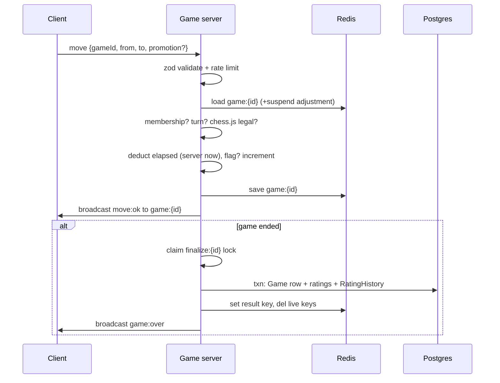

# Architecture

## Components

```mermaid
flowchart LR
  Browser["Browser<br/>(Next.js web app)"] -- "HTTPS + Socket.IO<br/>(JWT auth)" --> Web["apps/web<br/>Next.js App Router"]
  Browser -.->|Stockfish WASM in Web Worker<br/>(CDN, computer + review)| CDN[("jsDelivr CDN")]
  Web -- "Prisma" --> PG[("PostgreSQL<br/>users, games, ratings")]
  GameSrv["apps/game-server<br/>Socket.IO + chess.js"] -- "Prisma" --> PG
  GameSrv <-- "game state, queues,<br/>pub/sub adapter" --> Redis[("Redis")]
  Web -.->|"GET /api/socket-token<br/>(short-lived JWT)"| Browser
  Shared["packages/shared<br/>protocol, zod, elo, clocks"]
  DB["packages/db<br/>Prisma schema + client"]
  Web -.->|imports| Shared
  GameSrv -.->|imports| Shared
  Web -.->|imports| DB
  GameSrv -.->|imports| DB
```

- **apps/web** — pages, auth (NextAuth credentials + guests), REST for
  history/review data, Stockfish worker, zustand stores, typed Socket.IO client.
- **apps/game-server** — authoritative matches: validation, clocks,
  matchmaking, finalization. Never trusts the client.
- **packages/shared** — event names, zod schemas, Elo, clock math, constants.
- **packages/db** — Prisma schema, migrations, typed client, seed.

## Data model (PostgreSQL)

- `User(id, username!, email?, passwordHash?, isGuest, rating=1200,
  createdAt)` — indexes on `rating DESC`, `isGuest`.
- `Game(id, whiteId, blackId, pgn, result, termination, timeControl,
  white/blackRatingBefore/After, startedAt, endedAt)` — indexes on
  `(whiteId, endedAt)`, `(blackId, endedAt)`, `endedAt`.
- `RatingHistory(id, userId→User, gameId→Game, ratingAfter, createdAt)` —
  index on `(userId, createdAt)`.

Guests are full `User` rows (`isGuest`, no email/password) so ratings and
history work uniformly; the leaderboard filters them out.

## Redis keys

| Key | Type | Content |
|---|---|---|
| `game:{id}` | string (JSON) | live `GameState`: fen, moves, turn, clocks, increment, lastMoveAt, status, drawOfferBy, players, ratings-before, timeControl |
| `game:{id}:result` | string (JSON, TTL 24h) | finished summary so `rejoin` can answer `game:over` |
| `queue:{timeControl}` | zset (score = rating) | members `userId:rating:joinedAt` |
| `user:{id}:game` | string (TTL 6h) | current game id → reconnect routing + `ALREADY_IN_GAME` |
| `finalize:{id}` | string (TTL 10s) | cross-node finalization lock (`SETNX`) |
| `match:leader` | string (TTL 3s) | matchmaking sweep leadership |

Socket.IO rooms mirror this: `user:{id}` (per-player inbox, survives
reconnects) and `game:{id}` (both players + spectating tabs).

## Lifecycle of a move



## Clock design

- The server owns all clocks. `lastMoveAt` (server `Date.now()`) plus stored
  `whiteMs`/`blackMs` fully determine the position; increment is added only
  after a legal move.
- A 250ms ticker checks locally-known active games; on expiry the game ends
  as `TIMEOUT` (or `INSUFFICIENT_MATERIAL` draw in dead positions). A flag
  beats a move: if time ran out before the move arrived, the mover loses.
- Clients count down locally from the last `move:ok` values and resync on
  every `move:ok` (see `useCountdown`). Display may drift by <1 RTT by design.
- Graceful shutdown stamps `suspendedAt` on active games; the load path
  shifts `lastMoveAt` past the downtime so restarts never flag anyone.

## Reconnect design

- Every socket joins `user:{id}` on connect; game sockets join `game:{id}`.
- Disconnect leaves queues immediately and, if it was the user's last socket
  (multi-tab safe) and they are in a live game, starts a 45s grace timer and
  emits `opponent:disconnected`.
- `rejoin {gameId}` re-enters the room, cancels the timer, returns the full
  `game:start` snapshot, and emits `opponent:reconnected` (only if the player
  was actually away). The web client auto-rejoins after transport reconnects.
- Grace expiry forfeits: winner = opponent, `ABANDONED`.

## Matchmaking

1s sweep (any node holding the 3s leader lock may sweep; an immediate sweep
also runs on every `queue:join`). For each time control, seekers pair when
each is inside the other's window (`min(600, 100 + 50·⌊waited/5s⌋)`),
closest ratings first. Pairs are claimed with one atomic `ZREM` (count must
be 2; partial claims roll back), so no Lua is needed and concurrent nodes
cannot double-book. Colors are randomized; both sockets are added to the game
room with adapter-aware `socketsJoin` and receive `game:start`.

## Scaling notes

- Horizontal game servers work via the Socket.IO Redis adapter, **but sticky
  sessions are required** (the in-memory socket registry and grace timers are
  node-local). Terminate TLS at the load balancer with cookie/`ip_hash`
  affinity.
- Postgres is written only on game end (one transaction), so the hot path is
  Redis-only: ~2 round trips per move plus pub/sub fan-out.
- The 250ms ticker and 1s sweep are per-node and guarded (finalize lock,
  atomic claims, leader lock), so adding nodes is safe, just slightly
  redundant.

## Failure modes

| Failure | Behavior |
|---|---|
| Client clock skew | Irrelevant — server timestamps only |
| Redis down | Games pause (moves error); sockets stay up; recovers with Redis |
| Game node crash | Peers finalize via ticker; `user:{id}:game` TTL bounds staleness; suspended clocks only on graceful shutdown |
| DB down at game end | Finalize throws, lock released, live game stays in Redis; next move/tick retries |
| Engine CDN blocked | Computer/review show a friendly error; online play unaffected |
